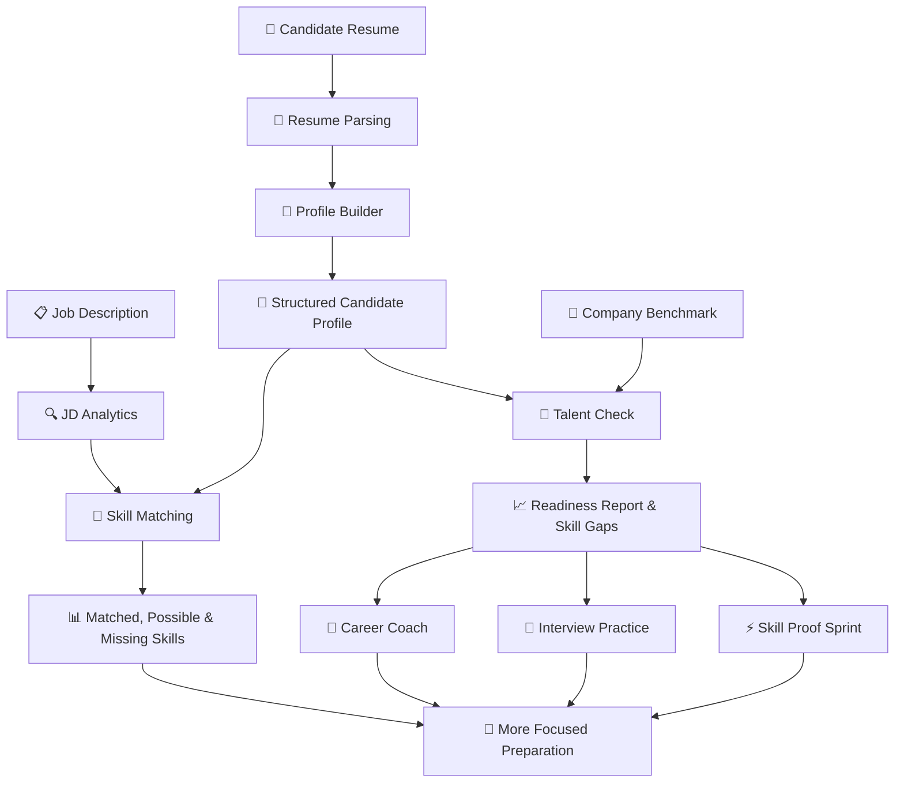

<div align="center">


### blitzkrieg
### Your Career. Decoded. Your Preparation. Strategized.

**An AI-powered career and placement intelligence platform built to help students understand employer expectations, identify skill gaps, and prepare with purpose.**

[🚀 Live Demo](https://jss-placement-intelligence-portal.vercel.app)

<br/>

*Stop preparing blindly. Start preparing strategically.*

</div>

---

## 🎯 The Problem

Every placement season, students face the same frustrating questions:

- What skills do companies actually expect from me?
- Does my resume demonstrate the skills required for a particular role?
- Where am I falling short of my target company's expectations?
- What should I work on first to improve my chances?

Students have resumes, job descriptions, learning resources, and countless preparation tools. But these resources often exist in isolation.

**Blitzkrieg brings them together into one connected preparation workflow.**

Built for students, recruiters, and placement teams at JSS University, Noida, Blitzkrieg transforms job descriptions and resumes into structured insights that help students make more informed preparation decisions.

Instead of simply asking, *"Am I ready?"*, Blitzkrieg helps students investigate the more useful question:

**"What evidence do I have, where are my gaps, and what should I do next?"**

---

## ✨ What Makes Blitzkrieg Different?

| Traditional Preparation | With Blitzkrieg |
|---|---|
| Guessing what employers expect | Extracting structured requirements from job descriptions |
| Manually reviewing lengthy resumes | Converting resumes into structured candidate profiles |
| Comparing skills mentally | Inspecting skill-level gaps against company benchmarks |
| Treating every skill match as certain | Separating confirmed matches from possible matches |
| Preparing without a clear direction | Using evidence and identified gaps to guide preparation |

Blitzkrieg is designed around **transparency, structured information, and actionable preparation insights**—not just another score on a dashboard.

---

## 🚀 Explore the Platform

Blitzkrieg connects five core modules into a single career-intelligence workflow.

### 01. 🔍 JD Analytics

**Understand the job before preparing for it.**

Upload a PDF or DOCX job description and extract its technical skills, tools, and other recognized requirements into a structured list.

**What it offers:**
- Automated job-description analysis.
- Categorized skill extraction.
- Supporting text evidence for extracted requirements.
- Confidence information associated with extraction results.
- A structured output that can inform later skill comparisons.

**Why it matters:** A lengthy job description becomes easier to inspect, helping students identify the requirements they should investigate and prepare for.

Route: `/jd-analytics`

### 02. 📄 Resume Parsing

**Turn an unstructured resume into structured candidate information.**

Upload a resume and extract relevant information into a reusable candidate profile.

**What it offers:**
- PDF and DOCX resume processing.
- Structured candidate information.
- Skill extraction with supporting evidence.
- AI-assisted extraction with a labeled local heuristic fallback.
- A structured handoff to the Profile Builder and other analysis workflows.

The parser checks whether extracted skill evidence is grounded in the document text. If AI extraction fails or cannot produce a valid result, the local fallback attempts to identify explicitly mentioned skills and tools.

**Why it matters:** A student's experience becomes easier to inspect and reuse across the platform.

Route: `/resume-profile`

### 03. 🧩 Profile Builder

**Your resume is the starting point, not the final word.**

The Profile Builder brings extracted candidate information into a structured workflow where it can be reviewed and refined.

**What it offers:**
- A candidate profile populated from resume information.
- A structured view of extracted details.
- An opportunity to review and correct information.
- A shared candidate-data workflow for downstream analysis.

**Why it matters:** Automated extraction is not infallible. Reviewing candidate information helps identify mistakes before they influence subsequent analysis.

Route: `/resume-profile`

### 04. 🎯 Talent Check

**Measure preparation against a specific company benchmark.**

Talent Check compares a parsed resume with a selected company's skill benchmark and generates a structured readiness report.

**What it offers:**
- A company directory containing 118 company options.
- Company-specific skill benchmarks where available.
- A readiness score and configured readiness classification.
- Skill-level gap analysis.
- RADIX-12 benchmark reporting and radar-chart data.
- An AI Career Coach.
- Interview Practice with generated questions and answer evaluation.
- Skill Proof Sprint challenges and solution evaluation.
- A downloadable Markdown report.

#### How the benchmark works

The current benchmark dataset contains:
- **113 companies** with company-specific skill profiles.
- **5 companies** using a clearly identified RADIX-wide fallback benchmark.
- A **12-skill RADIX profile** for the Talent Check workflow.

The source company-skill data uses a 1–10 scale, which Talent Check converts to a 1–5 scale for its report.

The five fallback profiles use the RADIX-wide median derived from the 113 complete company profiles. They are not represented as employer-specific skill data.

**Important:** A readiness score is a preparation indicator based on the configured benchmark. It is not a hiring prediction, a guarantee of selection, or a substitute for an employer's actual evaluation criteria.

Route: `/talent-check`

### 05. 🔗 Skill Matching

**Find out how your resume aligns with a specific job.**

Skill Matching compares the skills and evidence extracted from a resume against the requirements extracted from a job description.

**What it offers:**
- A resume-to-job comparison.
- Confirmed skill matches.
- Possible matches that require further inspection.
- Missing or unrecognized requirements.
- Supporting evidence for the comparison.
- A match score summarizing the results.

#### Three kinds of results

| Result | Meaning |
|---|---|
| ✅ Matched | An exact skill-name or recognized-alias match was identified. |
| 🟡 Possible match | Similar wording was identified, but the match is not sufficiently certain to be treated as confirmed. |
| ❌ Missing | A job requirement was not found among the candidate's extracted skills. |

**Why it matters:** A keyword appearing in a resume is not the same as verified proficiency. Keeping uncertain matches separate makes the analysis more transparent.

Route: `/skill-match`

---

## 🔄 The Blitzkrieg Workflow

The modules are designed to complement one another.



### From documents to decisions

1. **Understand the opportunity:** Analyze a job description.
2. **Understand the candidate:** Parse a resume into structured information.
3. **Refine the profile:** Review and correct extracted details.
4. **Assess readiness:** Compare the candidate with a selected company benchmark.
5. **Inspect alignment:** Identify matched, possible, and missing skills.
6. **Plan the next steps:** Use the reports and available preparation tools to guide further learning.

The result is a connected workflow rather than a collection of unrelated utilities.

---

## 🏢 Company Intelligence

Blitzkrieg also provides company-oriented discovery and skill intelligence.

| Module | Route | Purpose |
|---|---|---|
| Company Search | `/` | Search and select companies. |
| Company Intelligence | `/company/intelligence` | Explore company information and profiles. |
| Skill Intelligence | `/company/skills` | Review skill expectations and learning topics. |
| Company Comparison | `/company/compare` | Compare up to three companies. |

### Company comparison

Compare company profiles, skill expectations, and learning signals to understand how preparation priorities may differ across target employers.

### Skill Intelligence

Review skill expectations, rate your skills, and inspect potential gaps against selected company targets.

Student self-ratings are currently stored in browser local storage. They are not sent to Supabase.

---

## 🛠️ Tech Stack

Blitzkrieg combines a modern web frontend with a Python API and structured company data.

| Layer | Technology |
|---|---|
| Frontend | React |
| Language | TypeScript |
| Build tool | Vite |
| Styling | Tailwind CSS |
| UI primitives | Radix UI |
| Animations | Framer Motion |
| Charts | Recharts |
| Client-side routing | React Router |
| Data fetching | TanStack Query |
| Database integration | Supabase |
| Backend API | Python, FastAPI |
| Document processing | PDF and DOCX extraction |
| AI integrations | Gemini, OpenRouter, and OpenAI provider integrations |

### Why this stack?

- **React + TypeScript:** Build interactive interfaces with structured application data.
- **Vite:** Provide a fast frontend development and build workflow.
- **FastAPI:** Expose document-processing and analysis endpoints to the frontend.
- **Supabase:** Supply company information and skill-benchmark data.
- **Recharts:** Visualize skill comparisons and benchmark results.
- **AI-provider integrations:** Support document extraction and interactive preparation features when configured.

---

## 🏗️ Architecture Overview

At a high level, Blitzkrieg consists of three cooperating parts.

```text
┌───────────────────────────────────────────────┐
│              React + TypeScript               │
│                                               │
│  Company Intelligence · JD Analytics          │
│  Resume Parsing · Profile Builder             │
│  Talent Check · Skill Matching                │
└──────────────────────┬────────────────────────┘
                       │
            ┌──────────┴──────────┐
            │                     │
            ▼                     ▼
┌─────────────────────┐  ┌─────────────────────┐
│   FastAPI Backend   │  │   Supabase Data      │
│                     │  │                     │
│ JD Analysis         │  │ Company Profiles     │
│ Resume Parsing      │  │ Skill Levels         │
│ Skill Matching      │  │ Skill Topics         │
│ Talent Check        │  │ Reference Data       │
│ AI Preparation      │  │                     │
└──────────┬──────────┘  └─────────────────────┘
           │
           ▼
┌───────────────────────────────────────────────┐
│             Configured AI Providers           │
│                                               │
│ Extraction · Career Coach · Interview Practice│
│ Skill Proof Sprint                            │
└───────────────────────────────────────────────┘
```

This is a conceptual view of the architecture, not a complete deployment diagram. Provider availability and fallback behavior depend on the feature and its configuration.

### Backend API

The integrated FastAPI service exposes the following principal endpoints.

| Endpoint | Purpose |
|---|---|
| `GET /api/health` | Check service status and configured providers. |
| `POST /api/analyze` | Analyze a PDF or DOCX job description. |
| `POST /api/parse-resume` | Extract structured candidate information from a resume. |
| `POST /api/skill-match` | Compare resume skills with job requirements. |
| `GET /api/talent-check/companies` | Retrieve Talent Check company options and fallback information. |
| `POST /api/talent-check` | Generate a company-benchmark readiness report. |
| `POST /api/talent-check/coach` | Submit a question to the AI Career Coach. |
| `POST /api/talent-check/interview/questions` | Generate interview-practice questions. |
| `POST /api/talent-check/interview/evaluate` | Evaluate an interview-practice answer. |
| `POST /api/talent-check/sprint/challenge` | Generate a Skill Proof Sprint challenge. |
| `POST /api/talent-check/sprint/evaluate` | Evaluate a submitted sprint solution. |
| `POST /api/talent-check/report` | Return a downloadable Markdown report. |

Additional compatibility endpoints support the integrated Talent Match workflow.

Interactive API documentation is available at `/docs` when the local backend is running.

---

## ⚙️ Getting Started

Want to run Blitzkrieg locally? Follow these steps.

### Prerequisites

Install the following:

- Node.js **20.19+ or 22.12+**.
- Python **3.12+**.
- npm.
- A Supabase project if you want live company data.
- An AI-provider API key if you want AI-powered extraction and preparation features.

### 1. Clone the repository

```bash
git clone https://github.com/Hardik-Sharma-1005/blitzkrieg.git
cd blitzkrieg
```

### 2. Install frontend dependencies

```bash
npm install
```

### 3. Configure the backend

Navigate to the backend directory and create a virtual environment.

**Windows:**

```powershell
cd backend
py -3.12 -m venv .venv
.venv\Scripts\activate
pip install -r requirements.txt
cd ..
```

**macOS / Linux:**

```bash
cd backend
python3.12 -m venv .venv
source .venv/bin/activate
pip install -r requirements.txt
cd ..
```

### 4. Configure environment variables

Copy the root environment template:

```text
.env.example → .env.local
```

Set the Supabase URL and publishable key if you want live company data.

Next, copy the backend environment template:

```text
backend/.env.example → backend/.env
```

Configure the AI-provider variables required by the features you intend to use. Consult the environment templates and the provider configuration in the source code for the exact supported names and values.

For Talent Check's provider integrations, the project documents these variables:

```dotenv
GEMINI_API_KEY=your_gemini_api_key
LLM_PROVIDER=your_configured_provider
OPENROUTER_API_KEY=your_openrouter_api_key
OPENAI_API_KEY=your_openai_api_key
```

Configure only the variables supported by the relevant service and provider selection. The Gemini configuration for Talent Check is documented separately under `Talent Check/.env`.

**Security:** Keep actual environment files out of version control. Never put service-role keys, private API keys, or other secrets in frontend variables or commit them to GitHub.

### 5. Start the application

From the project root, run the integrated launcher:

```bash
py temprunner.py
```

The launcher starts the frontend and shared API at:

| Service | Local address |
|---|---|
| Frontend | `http://127.0.0.1:5173` |
| FastAPI backend | `http://127.0.0.1:8000` |
| Interactive API docs | `http://127.0.0.1:8000/docs` |

To run only the frontend:

```bash
npm run dev
```

The frontend-only command does not replace the backend required by document analysis and other API-backed features.

---

## 🧪 Validation and Development

### Build the frontend

```bash
npm run build
```

This runs the TypeScript build checks and generates the Vite production bundle.

### Preview the production build

```bash
npm run preview
```

### Verify bundled resume samples

```bash
python scripts/verify_resume_samples.py
```

This script verifies the bundled PDF and Word resume samples using offline extraction. It does not write files by default.

Use the optional `--write-output` argument only when you intend to refresh the local JSON output files under `output/resumes/`.

---

## 🤖 AI Behavior and Fallbacks

Blitzkrieg uses different processing paths depending on the feature.

### JD Analytics

The service attempts configured AI extraction with bounded requests. If extraction fails, the local fallback scans readable document text for explicit skill and tool names and returns supporting evidence.

The fallback can miss skills described indirectly. Image-only pages may also be unreadable to the local text-extraction path.

### Resume Parsing

The resume parser attempts AI-assisted extraction and validates the resulting evidence. When a configured provider is unavailable or the response fails validation, a labeled local heuristic fallback attempts to extract explicitly mentioned information.

The resume parser enforces a 12 MB upload limit, rejects unsupported files and likely job descriptions, and removes its temporary processing file after use.

### Talent Check

Talent Check's AI features can use Gemini and configured OpenRouter/OpenAI provider integrations, with bounded requests and fallback behavior.

These services support the Career Coach, interview practice, and Skill Proof Sprint workflows. Their availability depends on the configured providers and their API access.

### A note on AI confidence

A model's confidence label is not the same as a statistically measured precision or recall score.

Extraction quality should be evaluated against manually labeled reference documents before making numerical accuracy claims.

---

## 🔐 Data, Privacy, and Security

Blitzkrieg is a prototype and should be treated accordingly.

Important implementation details:

- Uploaded resumes are processed by the API; the documented resume endpoint does not store them in Supabase.
- Temporary resume-processing files are removed after processing.
- AI-provider requests send extracted document text to the configured provider. Some image-based JD processing may also send rendered page images.
- Student self-ratings are stored in browser local storage.
- Company data access depends on Supabase configuration and the relevant database policies.
- Bundled demo records should not be confused with verified employer information.
- The integrated API currently lacks authentication and rate limiting.

### Before public deployment

1. Implement authentication and authorization.
2. Add API rate limiting and appropriate request-size controls.
3. Review Supabase Row Level Security policies and public-read permissions.
4. Audit company JSON fields for sensitive or unapproved information.
5. Keep private keys on the server.
6. Review logging, retention, error handling, and third-party AI data-sharing implications.
7. Obtain consent before processing real candidates' resumes.

**The current integrated API should remain local or otherwise access-controlled until the necessary safeguards are implemented.**

---

## 📊 Data Integrity and Limitations

Blitzkrieg aims to make preparation more transparent, but its outputs have boundaries.

- **Company benchmarks are not live hiring criteria.** They should not be interpreted as verified requirements for a current job opening.
- **Fallback benchmarks are not employer-specific.** The application identifies the five companies using the RADIX-wide median.
- **Skill matches are not proof of proficiency.** Resume evidence can establish that a skill was mentioned, not that the candidate can independently demonstrate it.
- **Readiness scores are not hiring predictions.** They reflect the configured comparison methodology and benchmark data.
- **Extraction can be incomplete.** Indirectly expressed skills, unusual document layouts, and image-only content can affect results.
- **Demo data may be fictional.** Northstar Digital Lab and Meridian Cloud Services are fictional scenarios labeled in the interface. The bundled Accenture sample has not been independently verified.

These distinctions are important because useful career intelligence should make its assumptions visible rather than hide them behind a score.

---

## 🗺️ Roadmap

The following are potential next steps, not claims that these capabilities are already implemented.

- [ ] Evaluate JD extraction precision and recall using manually labeled documents.
- [ ] Improve extraction across unusual layouts and indirect skill descriptions.
- [ ] Expand evidence-grounded candidate-profile validation.
- [ ] Strengthen authentication, authorization, and API abuse protections.
- [ ] Improve benchmark provenance and refresh procedures.
- [ ] Add more systematic automated tests for end-to-end workflows.
- [ ] Improve the accessibility and usability of reports.
- [ ] Make it easier for students to translate identified gaps into concrete learning plans.

---

## 👥 Team

Blitzkrieg was developed collaboratively, with responsibilities spanning the product workflow, document intelligence, candidate profiling, readiness assessment, and skill matching.

| Team Member | Responsibility |
|---|---|
| **Hardik Sharma** | Scrum Master and Profile Builder |
| **Ishu** | JD Analytics |
| **Daksh** | Resume Parsing |
| **Vansh** | Talent Check |
| **Yash** | Skill Matching |

The team structure reflects the five-module demonstration workflow.

---

## 🤝 Contributing

Contributions, suggestions, and bug reports are welcome.

1. Explore the existing application and identify a concrete improvement.
2. Open an issue describing the problem or proposed enhancement.
3. Discuss the scope and expected behavior.
4. Implement and test the change.
5. Submit a pull request with a clear explanation of the implementation.

When contributing, avoid committing credentials, private candidate documents, generated personal information, or other sensitive data.

For bugs and feature requests, use the [GitHub Issues page](https://github.com/Hardik-Sharma-1005/blitzkrieg/issues).

---

## 📄 License

Check the repository for its current license information before redistributing or reusing the project.

---

<div align="center">

### ⚡ Better Preparation Starts With Better Information.

**Blitzkrieg — Understand the requirements. Identify the gaps. Prepare with purpose.**

[Explore the Live Demo](https://jss-placement-intelligence-portal.vercel.app)

</div>
